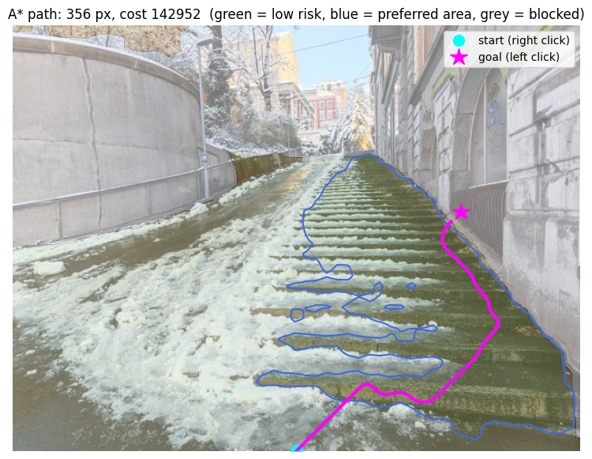
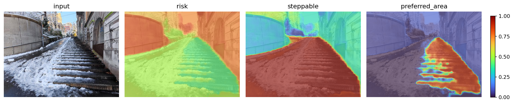
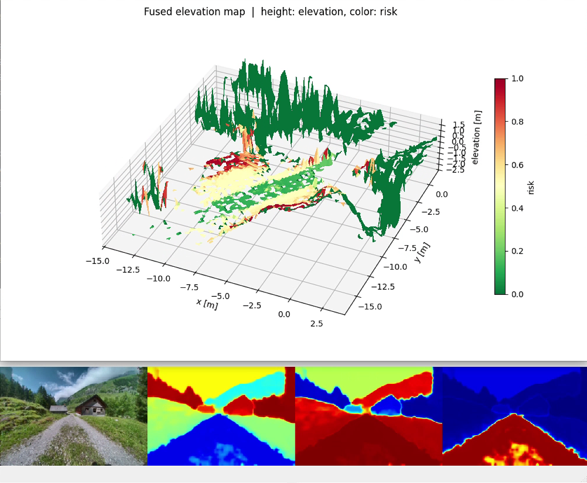

# dog_nav
run based ROAM from ETH

ETH的子刊论文《Bridging vision-language reasoning and learned control for legged navigation in the wild》, Science Robotics (2026)
的项目代码，已经配置好VLM语义识别，SAN分割，语义高程地图的生成。

仅为学习使用。

# Results：

## 2D图像的语义分割与路径规划
 
 

 

## 离线数据测试：
